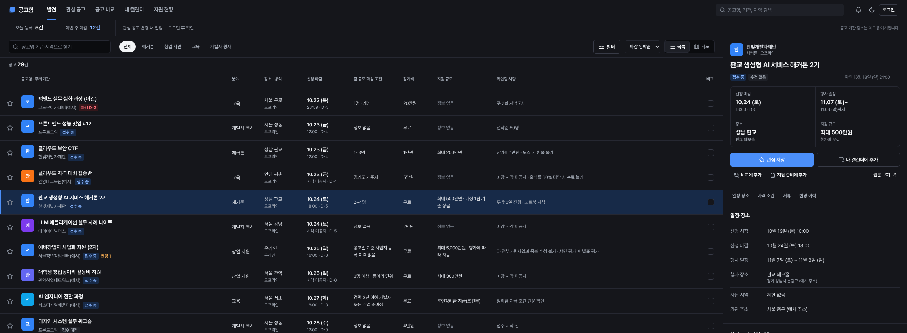
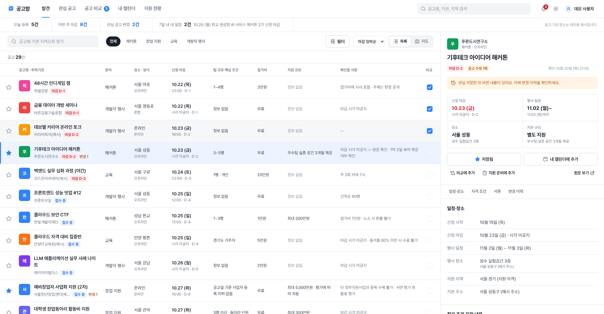
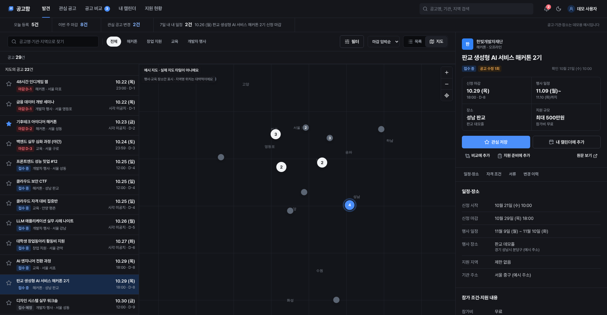

# 공고함

해커톤·창업 지원사업·교육·개발자 행사 공고를 **탐색 → 조건 검토 → 관심 저장 → 내 캘린더 → 알림**까지 한 흐름으로 관리하는 웹앱입니다.
2인 개발 포트폴리오를 가정해, 기능 수보다 핵심 흐름의 완성도와 상태 관리·접근성·반응형·데이터 설계·오류 처리를 드러내는 데 집중했습니다.

> **모든 공고·기관·장소는 데모용 합성 데이터입니다.** 실제 기관의 공고가 아니며, 원문 링크는 `example.com`을 가리킵니다.



| 발견(라이트) | 지도(다크) |
|---|---|
|  |  |

## 실행

```bash
pnpm install          # postinstall이 MapLibre worker를 public/vendor로 복사
pnpm dev              # http://localhost:3000
```

| 명령 | 설명 |
|---|---|
| `pnpm typecheck` | TypeScript strict 검사 |
| `pnpm lint` | ESLint (next core-web-vitals + typescript) |
| `pnpm test` | Vitest 단위 테스트 (일부러 `TZ=America/Los_Angeles`에서 실행) |
| `pnpm build` | 프로덕션 빌드 |
| `pnpm test:e2e` | Playwright E2E. 먼저 `pnpm build` 필요. 서버를 `DEMO_FIXED_NOW`로 띄워 날짜를 고정 |

Node 22, pnpm 10 기준입니다.

## 환경변수

`.env.example` 참고. **아무것도 설정하지 않아도 모든 화면이 동작합니다.**

| 변수 | 없을 때 동작 |
|---|---|
| `NEXT_PUBLIC_MAP_STYLE_URL` | 외부 타일 없는 ‘예시 지도’(배경·격자·대략적 지역명). 화면에 “예시 지도 · 실제 지도 타일이 아니에요” 표시 |
| `EMAIL_PROVIDER`, `EMAIL_API_KEY` | 이메일 채널 선택 불가, ‘설정되지 않음’ 표시 |
| `AI_API_KEY` | 데모 분석기(준비된 구조화 결과) 사용 |
| `DEMO_FIXED_NOW` | 요청 시각 기준으로 데모 날짜 생성 |

## 화면·기능

| 화면 | 주요 기능 |
|---|---|
| 발견 `/discover` | 촘촘한 표(데스크톱)·목록(모바일), 검색·분야·장소 지역·진행 방식·접수 상태·마감 포함·정렬, 목록/지도 전환, 오른쪽 상세 패널(태블릿 서랍, 모바일 바텀시트). **모든 탐색 상태는 URL query** (`q, cat, region, mode, status, closed, sort, view, id, bbox, quick`) |
| 지도 모드 `?view=map` | 목록 29% · 지도 43% · 상세 28%(1280px 이상), 같은 장소 묶음 마커, 클러스터, 목록↔마커 선택 연동, ‘이 지역 다시 검색’, 확대·축소, 내 위치(권한 거부 안내), 로딩·오류 상태 |
| 상단 요약 | 오늘 등록·이번 주 마감·관심 공고 변경·7일 내 일정. 같은 데이터에서 계산, 누르면 해당 필터/화면 |
| 관심 공고 `/saved` | 저장 목록, 저장 이후 변경된 공고만 보기, 되돌리기 |
| 공고 비교 `/compare` | 최대 3개, 항목명 고정 + 가로 스크롤, 없는 값은 ‘정보 없음’, 확인 필요 항목 모음 |
| 내 캘린더 `/calendar` | 월간 보기(방향키 이동), 날짜별·다가오는 일정, 종류 필터, 수정·삭제, 변경 확인 필요 처리, `.ics` 내보내기 |
| 알림 `/notifications` | 읽음/안 읽음, 모두 읽음, 관련 공고·일정 이동, 발송 실패 표시, 예약 알림 미리보기, 데모 알림 보내기, 데모 공고 변경 발생 |
| 지원 현황 `/applications` | 검토 중·준비 중·지원 완료·종료, 준비 서류 체크리스트, 메모, 연결 일정 |
| 설정 `/settings` | 최소 프로필(관심 분야·시도 단위 지역·경력 구간·팀 규모·필요 시 창업 업력), 공고 변경 알림 종류, 테마, 데모 초기화 |

## 실제 구현과 데모의 구분

| 영역 | 상태 |
|---|---|
| 공고 데이터 | **데모.** 타입이 있는 저장소 경계(`src/repositories`) 뒤의 합성 데이터 34건. 경계에서 Zod 검증 |
| 인증 | **데모.** ‘데모로 체험하기’는 합성 프로필로 로그인 상태만 표시. 비밀번호·토큰을 받거나 저장하지 않음 |
| 개인 상태(관심·일정·알림·지원 현황) | **데모.** 브라우저 localStorage에만 저장, Zod로 읽을 때 검증 |
| 조건 비교 | **실제 규칙.** 프로필 구간과 구조화 조건을 규칙으로 비교. 단정 불가 시 ‘확인 필요’. 점수 없음 |
| 조건 구조화·변경 요약(AI) | **데모.** 준비된 결과에 ‘AI 구조화(데모 데이터)’ 표시. 어댑터·스키마 검증·근거 확인은 구현 (`src/lib/ai`) |
| 일정·알림 시각 계산, `.ics` | **실제 구현** (단위 테스트) |
| 알림 발송 | **데모.** 서버 스케줄러 없음. 앱이 열려 있을 때(또는 다시 열 때) 도래한 알림을 앱 내 알림으로 생성. 브라우저를 닫은 동안에는 발송되지 않음 |
| 이메일 | **미구현.** 발송 인터페이스만 있음. 설정돼 있어도 실제 발송했다고 표시하지 않음 |
| 공고 변경 감지 | **데모.** 알림 화면에서 준비된 변경을 직접 발생시킴 |
| 지도 | 예시 지도(기본) 또는 환경변수의 실제 스타일 |
| 외부 캘린더 | `.ics` 일회성 내보내기만. 자동 동기화 없음 |

## 지도·이메일·AI·인증 연결

- **지도**: `NEXT_PUBLIC_MAP_STYLE_URL`에 MapLibre 스타일 URL을 넣으면 됩니다. 제공자의 attribution은 MapLibre 기본 컨트롤로 표시됩니다. 지도는 서울·경기 범위(`maxBounds`) 안에서만 움직이고 줌 8~16으로 제한해 불필요한 타일 요청을 줄입니다. 공개 타일 서버(예: OSM 기본 타일)를 운영에 직접 쓰지 마세요.
- **이메일**: `src/lib/notify/email.ts`의 `EmailSender`를 구현합니다. 발송은 서버 작업으로 옮기고, 아래 ‘서버 알림’ 조건을 지켜야 합니다.
- **AI**: `src/lib/ai/analyzer.ts`의 `AnnouncementAnalyzer`를 서버 전용 파일에서 구현합니다. 키는 서버에서만 쓰고, 공고 본문은 신뢰할 수 없는 입력으로 다루며(본문 속 지시 무시, 도구 권한 없음), 결과는 `schema.ts`로 검증하고 `keepGroundedConditions`로 원문에 없는 근거를 버립니다. 결과는 `공고 id + contentVersion`으로 캐시하고, 실패하면 원문 정보만 보여 줍니다. 사용자 프로필은 모델에 보내지 않습니다.
- **인증**: `src/lib/personal-store.ts`의 읽기·쓰기를 API 호출로 바꾸고, `LoginGateProvider`의 데모 시작 부분을 실제 로그인으로 교체합니다. 화면 컴포넌트는 `usePersonal()`만 쓰므로 그대로 둘 수 있습니다.
- **서버 알림(운영 시)**: 영속 예약 작업, 발송 시점에 최신 일정·설정 재확인, 중복 방지 키(현재 `eventId:reminderId:channel:timingKey` 규칙 재사용), 재시도·실패 기록, 일정 수정·삭제·알림 해제 시 이전 예약 무효화, 알림 링크의 소유자 검증이 필요합니다.

## 날짜·시간대 정책

- 서비스 기준 시간대는 **Asia/Seoul**. 서버·브라우저의 로컬 시간대와 무관하게 같은 결과가 나오도록 항상 `@date-fns/tz`의 `TZDate`를 거칩니다(테스트는 LA·뉴욕 시간대에서 실행).
- **시점**은 UTC ISO 문자열, **시각 없는 날짜**는 `YYYY-MM-DD`로 따로 저장합니다.
- 마감 시각이 공지되지 않으면 ‘시각 미공지’로 표시하고 **23:59를 지어내지 않습니다**. 그날 하루가 끝날 때까지 접수 중으로 봅니다.
- **상시 모집·예산 소진 시·미정**은 고정 마감일로 바꾸지 않고, 캘린더 마감 일정도 만들지 않습니다(준비 일정은 가능).
- 복수일 행사는 시작일·종료일을 유지합니다. 종일 일정은 `.ics`에서 `VALUE=DATE`, DTEND는 마지막 날 다음 날입니다.
- 알림: 종일 일정은 N일 전 오전 9시, 시각 일정은 N×24시간 전, ‘당일’은 오전 9시(일정이 9시 이전이면 1시간 전).
- **hydration**: 서버가 요청 시각을 한 번 정해(`connection()` 이후) 내려 주고, 데모 데이터는 그 날짜로 결정적으로 생성합니다. 브라우저는 서버 시각에 맞춘 시계를 1분 단위로만 갱신합니다.

## 주요 설계 판단

- **URL 상태와 개인 상태 분리**: 탐색 상태(필터·정렬·뷰·선택·지도 범위)는 URL, 개인 상태(관심·비교·일정·알림)는 저장소. 필터 변경은 history push, 공고 선택·검색어 입력은 replace.
- **목록·지도·요약이 같은 함수 사용**: `filterAnnouncements` 결과를 목록·지도·요약 수치가 함께 씁니다. 지도에는 그중 좌표가 있는 공고만, 나머지는 “온라인·장소 미정 N건” 안내.
- **위치 세 종류 분리**: 행사·교육 장소(`venue`, 지도 표시), 지원 자격 지역(`eligibilityRegions`, 조건), 기관 주소(`organizer.address`, 텍스트만). 장소 미정·온라인은 좌표 없음.
- **같은 장소 마커 묶음**: 겹친 마커를 하나로 묶고 눌러서 고르게 했습니다. 마커는 HTML 버튼이라 키보드·스크린 리더로 접근 가능하고, 지도 없이도 목록으로 모든 공고에 접근할 수 있습니다.
- **변경 확인 흐름**: 일정은 만들 때의 `contentVersion`을 기억합니다. 관련 변경(마감·장소·취소)이 생기면 ‘변경 확인 필요’를 띄우고, 사용자가 갱신하면 일정 시각이 바뀌어 **알림 키가 바뀌므로** 예전 시각 알림은 자동 무효, 새 시각으로 재계산됩니다.
- **전역 상태 라이브러리 없음**: `useSyncExternalStore` + 순수 상태 전환 함수(`personal-actions.ts`, 단위 테스트 대상).
- **MapLibre 6 worker**: 번들러가 worker 경로를 처리하지 못해 `public/vendor`로 복사해 `setWorkerUrl`로 지정합니다(postinstall·predev·prebuild).
- **Next.js 16 Cache Components**: 모든 페이지는 정적 셸 + 요청 시각 기반 동적 영역(Partial Prerender).

## 검증

- 단위 테스트(Vitest + Testing Library) 47개: URL 직렬화·필터·정렬, 지도 범위 일치, 조건 비교, 공고→일정 변환(시각 미공지·상시 모집·복수일), 중복 등록, 알림 시각·중복 방지·이메일 실패, 공고 변경 후 일정 갱신·알림 재계산, `.ics` 이스케이프·줄 접기·종일 DTEND, AI 결과 스키마·근거 확인, 데모 데이터 요건.
- E2E(Playwright, 데스크톱 20 + 모바일 2): 검색·필터 URL 복원과 뒤로 가기, 상세 직접 진입, 저장·비교 클릭이 행 선택을 일으키지 않음, 요약 수치 일치, 지도↔목록 선택 연동·수 일치, WebGL 실패 시 목록 사용, 데모 로그인 후 원래 동작 이어가기, 새로고침 후 유지, 비교 3개 제한, 열린 리다이렉트 차단, 프로필 조건 비교, 캘린더 등록·중복 방지·수정·삭제, 시각 미공지·상시 모집, 변경→알림→갱신, 데모 알림, `.ics` 다운로드, 모바일 시트·가로 넘침.

## 알려진 한계

- 개인 데이터가 브라우저에만 있어 기기 간 동기화가 없고, 다른 탭의 변경은 `storage` 이벤트로만 반영됩니다.
- 알림은 앱이 열려 있을 때만 만들어집니다. 브라우저 푸시·이메일 발송은 없습니다.
- 예시 지도는 실제 도로·지형이 없고, 지역명 위치는 대략적입니다.
- 월간 캘린더는 직접 구현한 단순 그리드이며 드래그·주간 시간표는 없습니다.
- 공고 수집기·변경 감지는 없습니다(데모 변경만).

## 운영 전 검토가 필요한 지점

- **데이터 이용 허락**: 실제 공고를 수집하려면 출처별 이용약관·robots 정책·저작권(원문 전재 vs 요약·링크) 확인이 필요합니다. 출처별 허용 범위·출처 표시 문구·가공 허용 여부는 `src/data/sources.ts`의 `SourcePolicy`로 관리하도록 경계를 만들어 두었습니다.
- **개인정보**: 프로필은 시·도 단위 지역, 경력 구간 등 최소 정보만 받고 이름·연락처·주소·이력서·주민번호는 받지 않습니다. 실제 계정 연결 시 수집·이용 동의, 보관 기간, 삭제 요청 처리, 이메일 주소의 처리 근거가 필요합니다.
- **AI 처리**: 외부 모델에 공고 본문을 보낼 때 출처의 가공 허용 여부를 확인해야 하고, 사용자 데이터는 보내지 않도록 유지해야 합니다.
- **지도·글꼴**: 지도 제공자 약관과 attribution, Pretendard(OFL-1.1) 라이선스 고지를 확인하세요.
